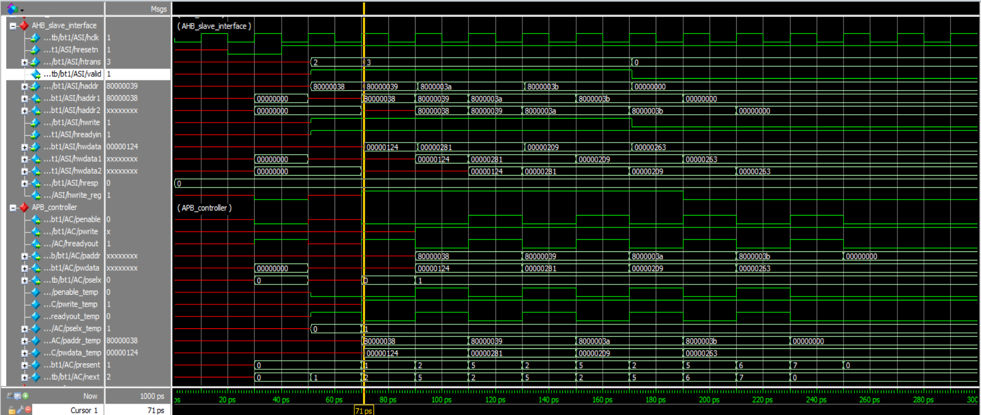
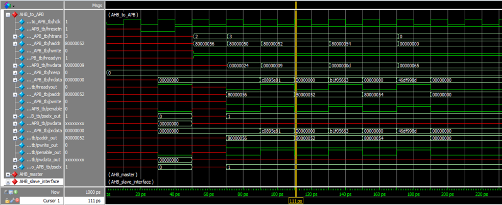
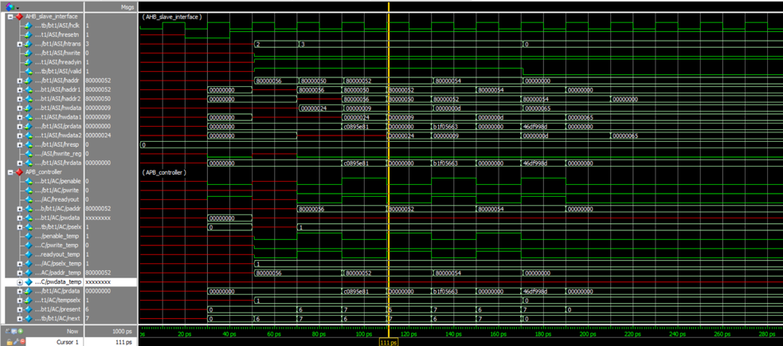

# AHB-to-APB Bridge

A Verilog HDL implementation of an AMBA AHB-to-APB bridge, developed as part of the Maven Silicon VLSI Design Internship (Batch DI 66). The design translates AHB-side transfers into APB-side peripheral transactions using address decoding, pipelined registers, and an FSM-based controller.

## Architecture

The design consists of four main blocks:

- **AHB Master** — generates AHB read and write transactions for simulation, including WRAP4 burst transfers.
- **AHB Slave Interface** — qualifies AHB transfers, pipelines address and write data, decodes the target peripheral, and forwards read data and response signals.
- **APB Controller** — sequences APB setup and enable phases using an eight-state finite-state machine.
- **APB Interface** — models the APB-side signals for simulation.

The top-level integration is implemented in `rtl/bridge_top.v`.

*Figure 1. System architecture of the AHB-to-APB bridge.*

*Figure 2. Top-level block diagram of the AHB-to-APB bridge.*

## AHB Slave Interface

| Signal | Description |
|---|---|
| `HCLK` | Clock for bus transfers |
| `HRESETn` | Active-low reset |
| `HTRANS[1:0]` | Transfer type: IDLE, BUSY, NONSEQUENTIAL, or SEQUENTIAL |
| `HWRITE` | Read/write direction |
| `HADDR[31:0]` | AHB address |
| `HWDATA[31:0]` | AHB write data |
| `HRDATA[31:0]` | Read data returned to the AHB master |
| `HREADYIN` / `HREADYOUT` | Transfer readiness and wait-state control |
| `HRESP[1:0]` | AHB response |

Address and write-data signals are pipelined through `haddr1`, `haddr2`, `hwdata1`, and `hwdata2`. A transfer is marked valid when `HREADYIN` is high, `HTRANS` indicates NONSEQUENTIAL or SEQUENTIAL, and the address is within the mapped region.

### Address decoding

The bridge decodes addresses from `0x8000_0000` up to (but not including) `0x8C00_0000` and produces a one-hot `tempselx[2:0]` selection:

| Address range | `tempselx` |
|---|---|
| `0x8000_0000`–`0x83FF_FFFF` | `3'b001` |
| `0x8400_0000`–`0x87FF_FFFF` | `3'b010` |
| `0x8800_0000`–`0x8BFF_FFFF` | `3'b100` |

## APB Controller FSM

The APB controller contains eight states:

| State | Function |
|---|---|
| `ST_IDLE` | Waits for a valid transfer |
| `ST_WWAIT` | Allows pipelined AHB write data to become available |
| `ST_WRITE` | Handles the APB write path |
| `ST_WRITEP` | Handles the pending-write path |
| `ST_WENABLE` | Completes the APB write enable phase |
| `ST_WENABLEP` | Coordinates pending transfers and write-to-read transitions |
| `ST_READ` | Initiates the APB read path |
| `ST_RENABLE` | Completes the APB read enable phase |

The controller generates `PADDR`, `PSELx[2:0]`, `PENABLE`, `PWRITE`, and `PWDATA`, while controlling `HREADYOUT` to coordinate AHB and APB timing.

*Figure 3. APB controller finite-state machine and state transitions.*

## Simulation Results

The following original ModelSim waveform captures from the project report illustrate the bridge's burst-write and burst-read activity and the corresponding internal signals.

*Figure 4. ModelSim waveform for a WRAP4 burst-write transfer.*

*Figure 5. Internal AHB Slave Interface and APB Controller waveform.*

*Figure 6. ModelSim waveform for a WRAP4 burst-read transfer.*

*Figure 7. Internal signal waveform for the read-transfer sequence.*

## Synthesis Results

The project report also contains Quartus synthesis views for the AHB Slave Interface logic, APB controller FSM, its state-transition table, and the top-level design hierarchy.

*Figure 8. Synthesized logic view of the AHB Slave Interface.*

*Figure 9. Synthesized APB controller FSM view.*

*Figure 10. APB controller state-transition table.*

*Figure 11. Top-level synthesis hierarchy of the bridge.*

## Repository Structure

- `rtl/` — Verilog RTL modules.
- `tb/` — simulation testbench.
- `synthesis/` — Quartus Prime project configuration.
- `doc/` — original project-report images embedded in this README.

## Tools

- Verilog HDL
- Intel Quartus Prime
- ModelSim / QuestaSim-compatible simulation files

## Running

1. Open the Quartus project under `synthesis/synth_bridge_top/`.
2. Compile the RTL modules with the relevant testbench in a Verilog simulator.
3. Run the simulation and inspect AHB/APB control and data signals.
