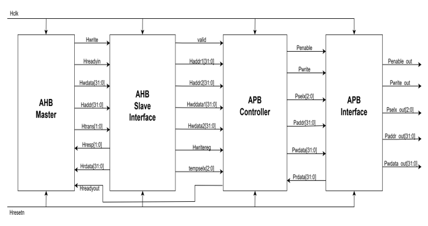
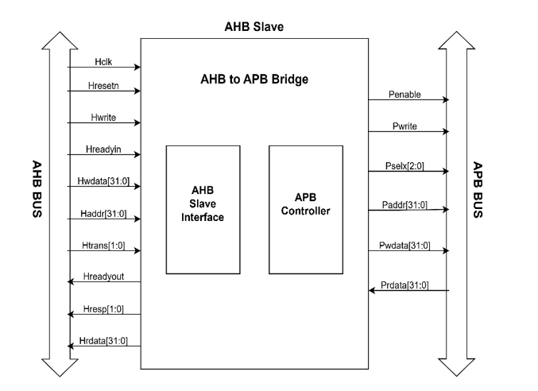
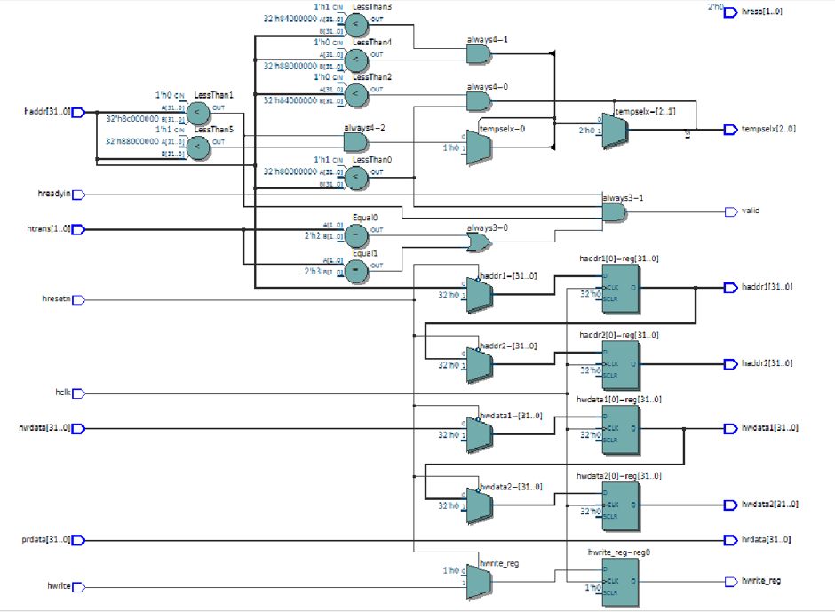
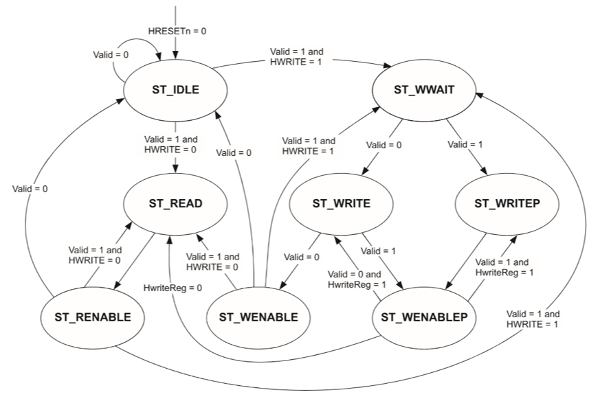
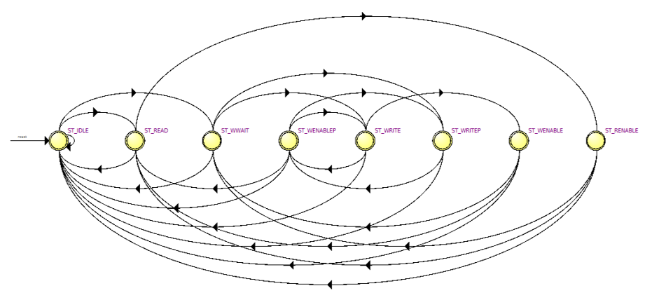
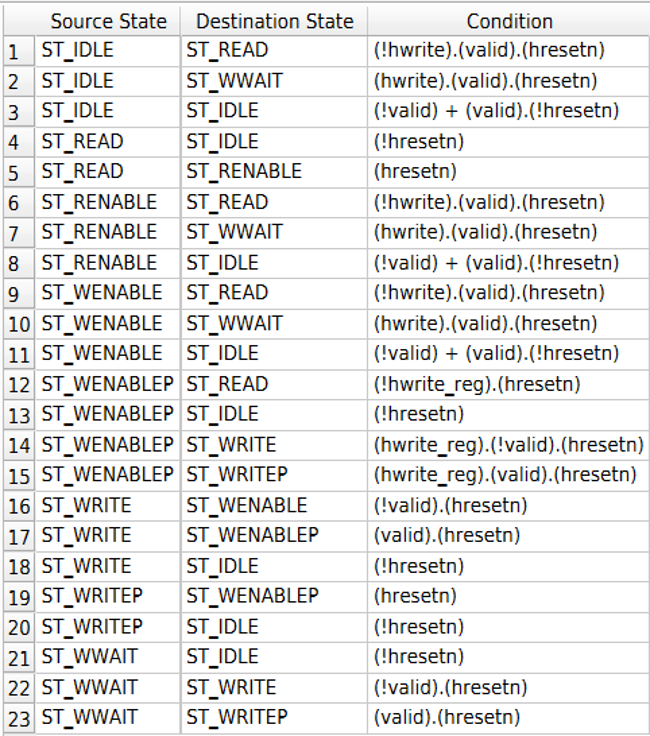
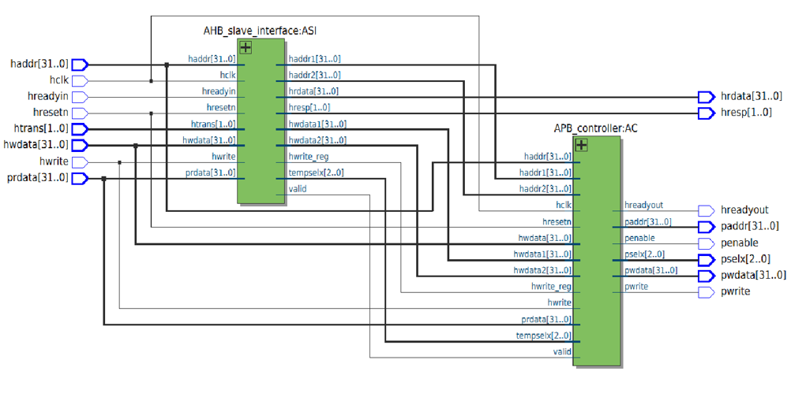

# AHB-to-APB Bridge

A Verilog HDL implementation of an AMBA AHB-to-APB bridge. The design translates AHB-side transfers into APB-side peripheral transactions using address decoding, pipelined registers, and an FSM-based controller.

## Architecture

The design consists of four main blocks:

- **AHB Master** — generates AHB read and write transactions for simulation, including WRAP4 burst transfers.
- **AHB Slave Interface** — qualifies AHB transfers, pipelines address and write data, decodes the target peripheral, and forwards read data and response signals.
- **APB Controller** — sequences APB setup and enable phases using an eight-state finite-state machine.
- **APB Interface** — models the APB-side signals for simulation.

The top-level integration is implemented in `rtl/bridge_top.v`.

*Figure 1. System architecture of the AHB-to-APB bridge.*

*Figure 2. Top-level block diagram of the AHB-to-APB bridge.*

## AHB Slave Interface

The AHB Slave Interface qualifies incoming transfers, pipelines the address and write-data paths, decodes the target APB peripheral, and forwards read data and response signals.

### AHB signal descriptions

The following descriptions follow the signal section in the project report. The RTL uses the corresponding lowercase signal names.

| Signal | Description |
|---|---|
| `HCLK` | Clock that times bus transfers. Signal timing is related to the rising edge of this clock. |
| `HRESETn` | Active-low bus reset used to reset the system and bus logic. |
| `HTRANS[1:0]` | Indicates the current transfer type: NONSEQUENTIAL, SEQUENTIAL, IDLE, or BUSY. |
| `HWRITE` | HIGH indicates a write transfer; LOW indicates a read transfer. |
| `HADDR[31:0]` | 32-bit system address bus. |
| `HWDATA[31:0]` | Write-data bus used by the master to send data to the selected slave during write transfers. |
| `HRDATA[31:0]` | Read-data bus driven by the slave during read transfers so the master can receive data. |
| `HREADY` | Transfer-status signal: HIGH indicates completion; LOW extends the transfer to allow more time. In this RTL, the readiness interface is represented by `hreadyin` and `hreadyout`. |
| `HRESP[1:0]` | Slave transfer-response signal. The report describes response meanings such as OKAY, ERROR, RETRY, and SPLIT. In the supplied RTL, `hresp` is tied to zero. |

### Address and data pipelining

Address and write-data signals are pipelined through `haddr1`, `haddr2`, `hwdata1`, and `hwdata2`. The write direction is also registered as `hwrite_reg`.

A transfer is marked valid when `HREADYIN` is HIGH, `HTRANS` indicates NONSEQUENTIAL or SEQUENTIAL, and the address is within the mapped region.

### Address decoding

The bridge decodes addresses from `0x8000_0000` up to (but not including) `0x8C00_0000`, covering the 192 MB address space stated in the report. It generates a one-hot `tempselx[2:0]` selection for three APB peripheral regions:

| Address range | `tempselx` |
|---|---|
| `0x8000_0000`–`0x83FF_FFFF` | `3'b001` |
| `0x8400_0000`–`0x87FF_FFFF` | `3'b010` |
| `0x8800_0000`–`0x8BFF_FFFF` | `3'b100` |

*Figure 8. Synthesized logic view of the AHB Slave Interface.*

## APB Controller

The APB Controller is implemented as an eight-state finite-state machine that sequences read and write transfers between the pipelined AHB side and the APB side.

### APB signal descriptions

The following signal descriptions follow the APB Controller section of the project report. The RTL uses lowercase port names such as `paddr`, `pselx`, and `penable`.

| Signal | Description |
|---|---|
| `PCLK` | APB clock used to synchronize transfers on the bus. |
| `PRESET` | Active-low reset signal, normally connected directly to the system reset. |
| `PADDR[31:0]` | Address bus carrying the target peripheral address from the AHB-to-APB bridge. |
| `PSELx[2:0]` | Peripheral-select signals, one per slave, used to activate the selected peripheral. |
| `PENABLE` | Strobe indicating the second phase of an APB transfer. |
| `PWRITE` | Transfer direction: HIGH for writes and LOW for reads. |
| `PRDATA[31:0]` | Read-data bus driven by the selected peripheral during read cycles. |
| `PWDATA[31:0]` | Write-data bus driven by the bridge during write cycles. |

### Controller states

| State | Function described in the project |
|---|---|
| `ST_IDLE` | Waits for a valid transfer. The select and enable lines are driven LOW; other bus outputs retain their previous values. |
| `ST_READ` | Drives the decoded address to `PADDR`, asserts the selected `PSEL` line, and sets `PWRITE` LOW. A wait state is inserted so APB read data can be driven to `HRDATA`. |
| `ST_WWAIT` | Allows the pipelined AHB write transfer to complete so write data becomes available on `HWDATA`; the APB write transfer starts in the following cycle. |
| `ST_WRITE` | Drives the decoded address to `PADDR`, asserts the selected `PSEL` line, and sets `PWRITE` HIGH. |
| `ST_WRITEP` | Performs the pending-write path with a wait state, allowing the AHB data phase to complete before the APB transfer proceeds. |
| `ST_WENABLE` | Completes the APB write enable phase. |
| `ST_WENABLEP` | Coordinates the pending-transfer path using the registered write direction. |
| `ST_RENABLE` | Completes the APB read enable phase. |

The controller generates `PADDR`, `PSELx[2:0]`, `PENABLE`, `PWRITE`, and `PWDATA`, while controlling `HREADYOUT` to coordinate AHB and APB timing.

*Figure 3. APB controller finite-state machine and state transitions.*

## Simulation Results

Detailed waveform screenshots and explanations for the WRAP4 burst-write, WRAP4 burst-read, and internal controller signals are maintained separately in [`results/README.md`](results/README.md).

## Synthesis Results

The project report also contains Quartus synthesis views for the AHB Slave Interface logic, APB controller FSM, its state-transition table, and the top-level design hierarchy.

*Figure 8. Synthesized logic view of the AHB Slave Interface.*

*Figure 9. Synthesized APB controller FSM view.*

*Figure 10. APB controller state-transition table.*

*Figure 11. Top-level synthesis hierarchy of the bridge.*

## Repository Structure

- `rtl/` — Verilog RTL modules.
- `tb/` — simulation testbench.
- `synthesis/` — Quartus Prime project configuration.
- `doc/` — original project-report images embedded in this README.

## Tools

- Verilog HDL
- Intel Quartus Prime
- ModelSim / QuestaSim-compatible simulation files

## Running

1. Open the Quartus project under `synthesis/synth_bridge_top/`.
2. Compile the RTL modules with the relevant testbench in a Verilog simulator.
3. Run the simulation and inspect AHB/APB control and data signals.
