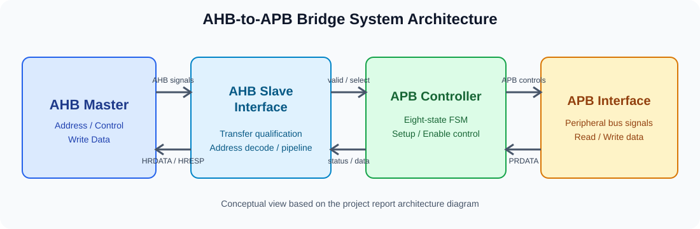
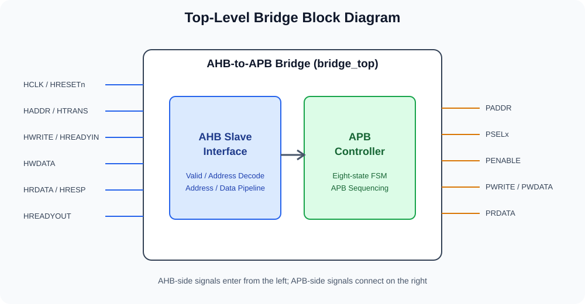
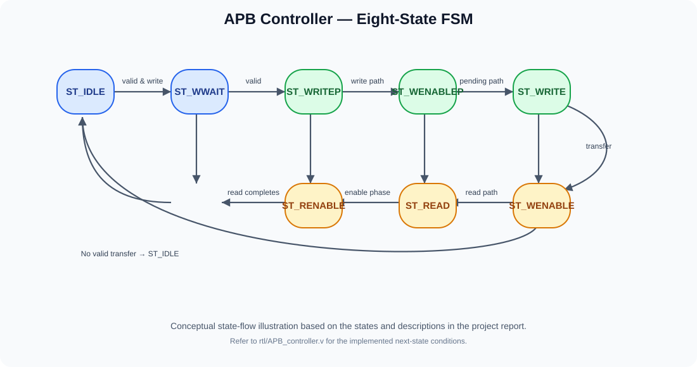
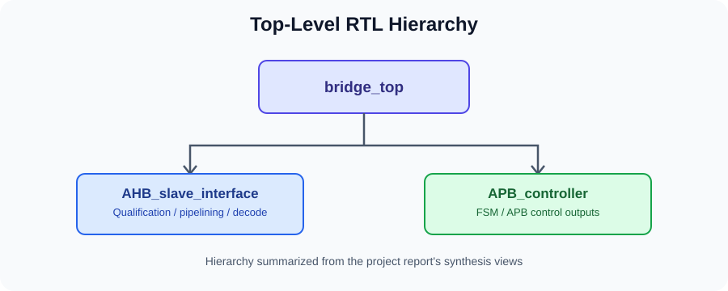

# AHB-to-APB Bridge

A Verilog HDL implementation of an AMBA AHB-to-APB bridge, developed as part of the Maven Silicon VLSI Design Internship (Batch DI 66). The design translates AHB-side transfers into APB-side peripheral transactions using address decoding, pipelined registers, and an FSM-based controller.

## Architecture

The design is organized into four main blocks:

- **AHB Master** — generates AHB read and write transactions for simulation, including WRAP4 burst traffic.
- **AHB Slave Interface** — qualifies incoming AHB transfers, pipelines address and write data, decodes the target peripheral, and forwards read data and response signals.
- **APB Controller** — sequences APB setup and enable phases using an eight-state finite-state machine.
- **APB Interface** — models the APB-side signals for simulation.

The top-level integration is implemented in `rtl/bridge_top.v`.

## System Block Diagram

## AHB Slave Interface

The AHB-side interface uses the following signals:

| Signal | Description |
|---|---|
| `HCLK` | Clock for bus transfers |
| `HRESETn` | Active-low reset |
| `HTRANS[1:0]` | Transfer type: IDLE, BUSY, NONSEQUENTIAL, or SEQUENTIAL |
| `HWRITE` | Read/write direction |
| `HADDR[31:0]` | AHB address |
| `HWDATA[31:0]` | AHB write data |
| `HRDATA[31:0]` | Read data returned to the AHB master |
| `HREADYIN` / `HREADYOUT` | Transfer readiness and wait-state control |
| `HRESP[1:0]` | AHB response |

Address and write-data signals are pipelined through `haddr1`, `haddr2`, `hwdata1`, and `hwdata2`. A transfer is marked valid when `HREADYIN` is high, `HTRANS` indicates NONSEQUENTIAL or SEQUENTIAL, and the address is within the bridge's mapped region.

### Address decoding

The bridge decodes addresses in the range `0x8000_0000` to `0x8BFF_FFFF` and produces a one-hot `tempselx[2:0]` selection:

| Address range | `tempselx` |
|---|---|
| `0x8000_0000`–`0x83FF_FFFF` | `3'b001` |
| `0x8400_0000`–`0x87FF_FFFF` | `3'b010` |
| `0x8800_0000`–`0x8BFF_FFFF` | `3'b100` |

## APB Controller

The APB controller coordinates the AHB pipeline with the APB setup and enable phases. Its eight states are:

| State | Purpose |
|---|---|
| `ST_IDLE` | Waits for a valid transfer and keeps the peripheral selection and enable inactive when idle |
| `ST_WWAIT` | Allows pipelined AHB write data to become available |
| `ST_WRITE` | Drives the APB write phase |
| `ST_WRITEP` | Handles the pending-write path and its wait-state sequencing |
| `ST_WENABLE` | Completes an APB write enable phase |
| `ST_WENABLEP` | Coordinates a pending transfer, including the write-to-read transition |
| `ST_READ` | Sets up the APB read transfer |
| `ST_RENABLE` | Completes the APB read enable phase |

The controller generates `PADDR`, `PSELx[2:0]`, `PENABLE`, `PWRITE`, and `PWDATA`, while controlling `HREADYOUT` to coordinate transfer timing.

## Simulation

The project report documents RTL simulation waveforms for:

- WRAP4 burst write transfer
- WRAP4 burst read transfer

The waveforms are used to observe the AHB-side transfer sequence and the APB control/data signals, including `PSELx`, `PENABLE`, `PADDR`, `PWDATA`, and `HREADYOUT`.

## Synthesis

The report includes synthesis views for the AHB Slave Interface, APB Controller state machine, and top-level bridge hierarchy.

## Repository Structure

- `rtl/` — Verilog RTL modules.
- `tb/` — simulation testbench.
- `synthesis/` — Quartus Prime project configuration.
- `docs/images/` — architecture and design diagrams.

## Tools

- Verilog HDL
- Intel Quartus Prime
- ModelSim / QuestaSim-compatible simulation files

## Running

1. Open the Quartus project under `synthesis/synth_bridge_top/`.
2. Compile the RTL modules with the relevant testbench in a Verilog simulator.
3. Run the simulation and inspect the AHB and APB control and data signals.
