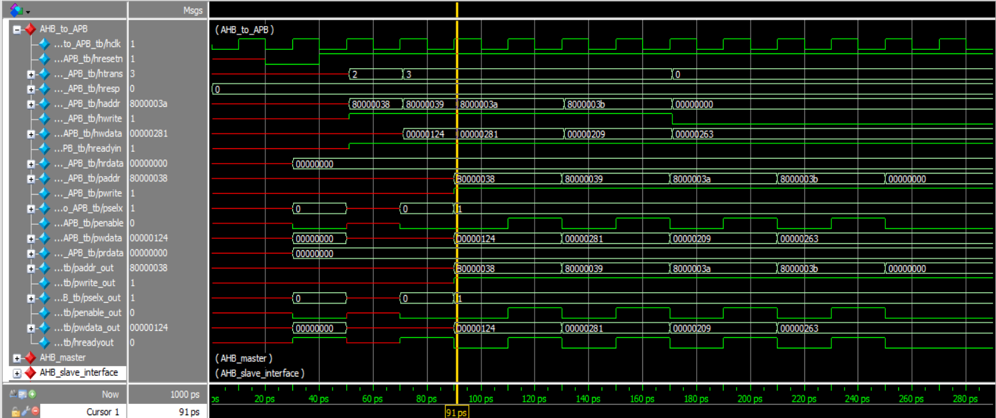

# Simulation Results and Waveform Analysis

This folder collects the original ModelSim waveform screenshots from the project report and explains the bus activity visible in each capture. The screenshots are reused as uploaded; they have not been redrawn or altered.

## 1. WRAP4 Burst-Write Transfer

**Figure R1. ModelSim waveform for a WRAP4 burst-write transfer.**

The waveform shows the AHB-side burst-write sequence and the corresponding APB-side activity. Follow the address and write-data signals alongside `HWRITE`, `HTRANS`, `PSELx`, `PENABLE`, `PWRITE`, `PADDR`, and `PWDATA`. The address advances through the burst beats, while the controller sequences the APB transfer phases. The visible waveform is the simulation evidence from the report; this explanation does not assume additional protocol checks beyond the signals shown.

## 2. AHB Slave Interface and APB Controller Internal Signals

**Figure R2. Internal AHB Slave Interface and APB Controller signals during simulation.**

This capture exposes internal signals in addition to the bus-level outputs. It is useful for correlating the AHB input address/data pipeline (`haddr1`, `haddr2`, `hwdata1`, and `hwdata2`) with controller signals such as `present`, `next`, `valid`, `pselx_temp`, and `penable_temp`. The state and temporary output signals help explain how the controller responds to a valid transfer and advances between its read/write states.

## 3. WRAP4 Burst-Read Transfer

**Figure R3. ModelSim waveform for a WRAP4 burst-read transfer.**

The waveform captures an AHB read burst and the resulting APB read-side control activity. Compare the AHB address and transfer signals with `PSELx`, `PENABLE`, `PWRITE`, and `PADDR`. For a read, `PWRITE` is LOW; read data is represented by `PRDATA` on the APB side and is passed toward the AHB read-data path as shown by the design. The displayed values are those in the report's simulation capture.

## 4. Read-Transfer Internal Signals

**Figure R4. Internal signal waveform for the read-transfer sequence.**

This view focuses on the internal AHB slave and APB controller signals during a read sequence. The registered address/data paths and FSM state signals can be inspected alongside the APB outputs to see how the selected peripheral, address, and enable control evolve over time.

## Signal reference

| Signal | Role in waveform analysis |
|---|---|
| `HADDR` / `haddr1` / `haddr2` | AHB address and its pipelined copies |
| `HTRANS` | Indicates whether the AHB transfer is IDLE, BUSY, NONSEQUENTIAL, or SEQUENTIAL |
| `HWRITE` / `hwrite_reg` | Current and registered transfer direction |
| `HWDATA` / `hwdata1` / `hwdata2` | AHB write data and its pipelined copies |
| `valid` | Indicates a qualifying AHB transfer in the bridge logic |
| `PADDR` | Address presented to the APB peripheral |
| `PSELx` | Selects the target APB peripheral |
| `PENABLE` | Indicates the APB access phase |
| `PWRITE` | HIGH for APB write; LOW for APB read |
| `PWDATA` | Write data presented on APB |
| `PRDATA` / `HRDATA` | APB read data and AHB read-data path |
| `present` / `next` | Current and next FSM states in the controller |

These notes describe the signals and activity visible in the supplied report images. For exact cycle-by-cycle interpretation, use the waveform cursors and the corresponding RTL state-transition logic.
